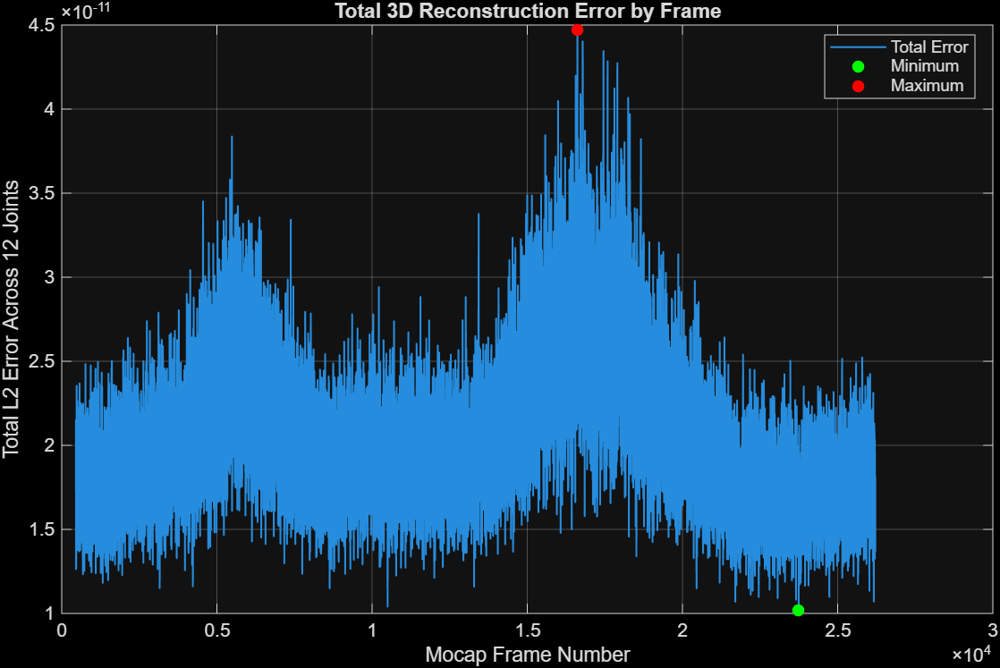

# Camera Projection and 3D Reconstruction

A MATLAB computer-vision project implementing camera projection, inverse projection, and two-view triangulation.

**Author:** Nihat Hasan  
**Course:** CMPEN/EE 454, Penn State

[Read the project report](report.pdf)

## Overview

This project takes known 3D motion-capture coordinates for 12 body joints, projects them into two calibrated camera views, and reconstructs the original coordinates using triangulation.

The implementation explores camera geometry through numerical evaluation, skeleton visualizations, and epipolar lines.

## Features

- Forward projection from 3D world coordinates to 2D pixels.
- Backprojection from pixels to world-coordinate viewing rays.
- Two-view triangulation using the midpoint of the closest points on paired rays.
- Reconstruction-error evaluation across valid motion-capture frames.
- Projected 2D skeletons and original/reconstructed 3D skeletons.
- Epipolar-line visualizations and MATLAB runtime profiling.

## Recorded results

The original evaluation covered **25,758 frames**, each containing 12 valid joints.

| Metric | Recorded value |
| --- | ---: |
| Mean joint reconstruction error | 1.7093e-12 |
| Maximum joint reconstruction error | 9.5612e-12 |

Errors are Euclidean distances in the dataset's coordinate units. Near-zero error is expected in this controlled round-trip test because the image points are generated from known 3D coordinates using the same calibrated camera model.

[View the per-joint statistics](Project2_statistics.csv).



## Run the project

MATLAB is required.

1. Download or clone this repository.
2. Download both video inputs:
   - [Vue2 video](https://github.com/hvsxn/camera-projection-3d-reconstruction/releases/download/data-v1/Subject4-Session3-24form-Full-Take4-Vue2.mp4)
   - [Vue4 video](https://github.com/hvsxn/camera-projection-3d-reconstruction/releases/download/data-v1/Subject4-Session3-24form-Full-Take4-Vue4.mp4)
3. Keep the original video filenames and place both MP4 files alongside the MATLAB scripts.
4. Open that directory as MATLAB's Current Folder.
5. Run:

```matlab
project2Demo
```

The repository includes the required motion-capture and calibration files:

- `Subject4-Session3-Take4_mocapJoints.mat`
- `vue2CalibInfo.mat`
- `vue4CalibInfo.mat`

## Main files

| File | Purpose |
| --- | --- |
| `project2Demo.m` | Runs the complete demonstration and evaluation |
| `myProjectPoints.m` | Projects 3D points into image coordinates |
| `myPixelToRay.m` | Converts image coordinates into viewing rays |
| `myTriangulateRays.m` | Reconstructs points from paired rays |
| `evaluateReconstruction.m` | Computes reconstruction errors and statistics |
| `drawSkeleton2D.m`, `drawSkeleton3D.m` | Draw skeleton visualizations |
| `showErrorFrames.m` | Displays minimum- and maximum-error examples |
| `showEpipolarLines.m` | Visualizes two-view epipolar geometry |

## Scope and limitations

The evaluation measures the numerical consistency of projection and reconstruction using calculated image coordinates. Performance with noisy or automatically detected image points was not evaluated.

Radial lens distortion is ignored, following the assignment setup.

## Project context

Completed as a CMPEN/EE 454 course project. Motion-capture data, calibration parameters, and video inputs were supplied with the assignment.

ChatGPT assisted with documentation and coding guidance.
